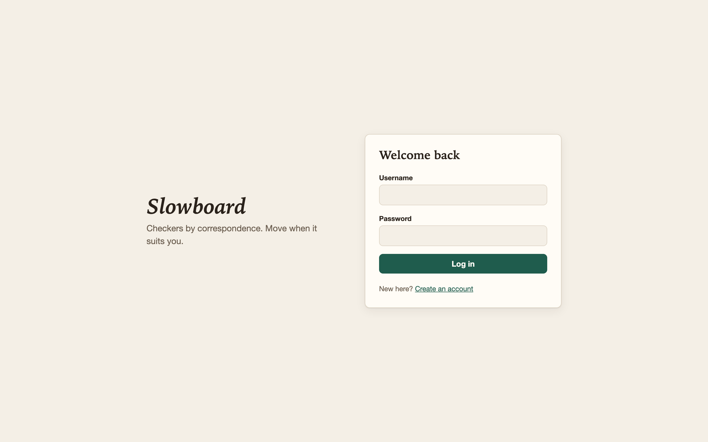
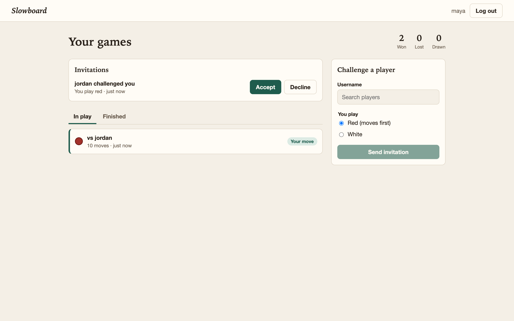
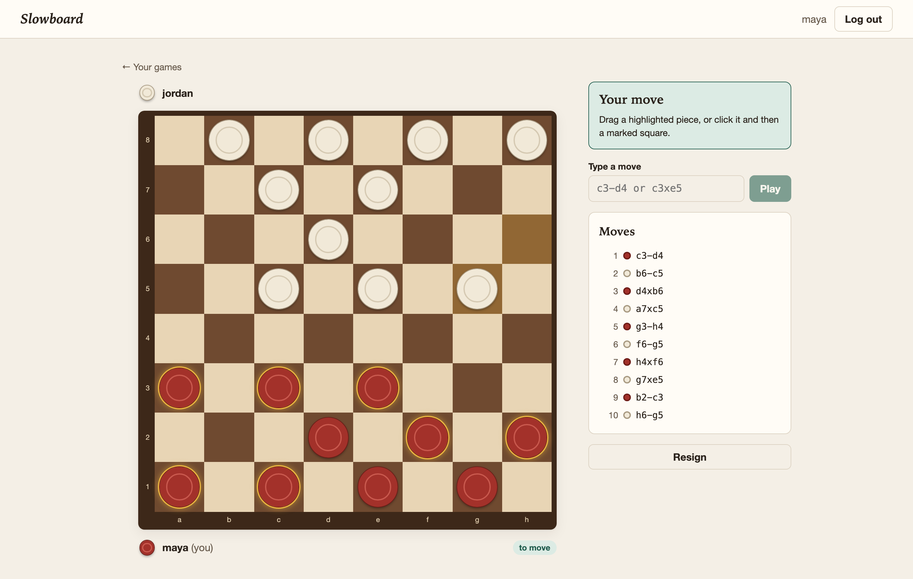
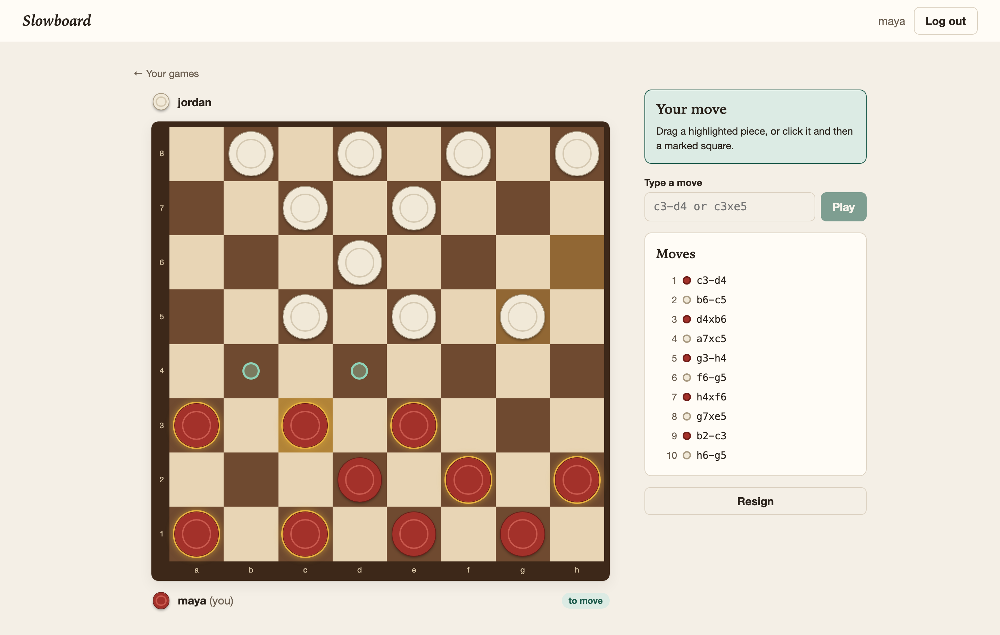
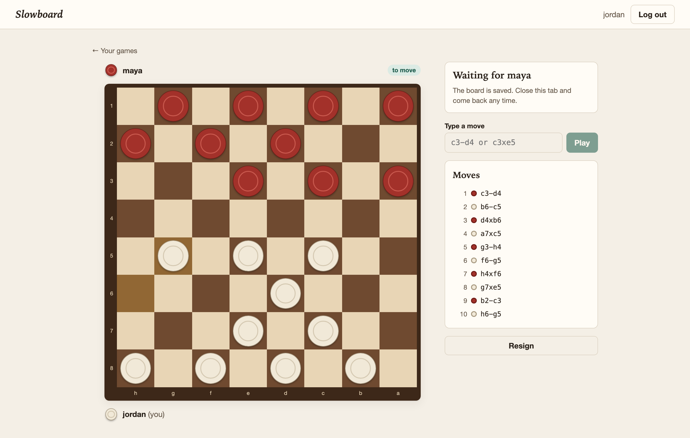
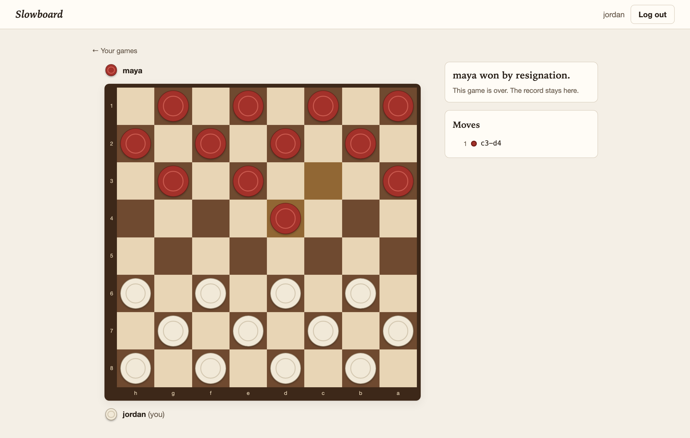

# Slowboard

Correspondence checkers. Invite an opponent to a persistent board, then each make your moves whenever suits you. Every game lives in the database, so you can close the tab and come back days later.

Built with Django REST Framework and React with TypeScript for CSC 3210.

## Screenshots

A game between two players, `maya` (red) and `jordan` (white).

**Login**



**Dashboard**, with a pending invitation, a game in play, the player's record and the form for challenging someone



**A game in progress**, from red's side. Pieces that can move are outlined in gold, and the move history lists every move in notation, including captures.



**Choosing a move.** Clicking a piece marks the squares it can legally move to.



**The same game from white's side.** The board is flipped, and the player waits for their opponent to move.



**A finished game**, won by resignation



## Run it locally

You need Python 3.12+ and Node 20+. Use two terminals.

**Backend** (http://localhost:8000)

```bash
cd backend
python3 -m venv .venv
source .venv/bin/activate
pip install -r requirements-dev.txt
cp .env.example .env        # then set SECRET_KEY; the command is in the file
python manage.py migrate
python manage.py runserver
```

**Frontend** (http://localhost:5173)

```bash
cd frontend
npm install
cp .env.example .env
npm run dev
```

To try a game alone, register two accounts, one in a normal window and one in a private window. Send an invitation from one and accept it from the other.

## Rules

English draughts on an 8x8 board. Red sits on ranks 1-3 and moves first.

- Men move and capture diagonally forward. Kings move and capture in all four directions.
- Capturing is mandatory, and a multi-jump must be finished. If several captures are available, you can choose any of them.
- A man that reaches the far rank is crowned, and its turn ends.
- You lose if you have no legal move on your turn. You can also resign at any time.
- The game is drawn after 40 moves by each side with no capture and no man moving.

## Move notation

| Text       | Meaning                               |
| ---------- | ------------------------------------- |
| `c3-d4`    | Step from c3 to d4                    |
| `c3xe5`    | Jump from c3 to e5                    |
| `c3xe5xg7` | Double jump from c3 through e5 to g7  |

Files are `a`-`h` from Red's left and ranks are `1`-`8` from Red's side. The dark corner `a1` is at Red's bottom left.

## How it works

### Backend

| Path                       | Responsibility                                                  |
| -------------------------- | --------------------------------------------------------------- |
| `backend/games/engine.py`  | Rules and notation as plain Python, with no Django dependency   |
| `backend/games/models.py`  | Relational schema and database constraints                      |
| `backend/games/services.py`| State changes, each in one transaction                          |
| `backend/games/views.py`   | DRF viewsets, query optimisation and permissions                |
| `backend/config/exceptions.py` | One error shape for the whole API                           |

**Data model**

| Model           | Relationship                                             | Purpose                               |
| --------------- | -------------------------------------------------------- | ------------------------------------- |
| `PlayerProfile` | One-to-one with `User`                                   | Win, loss and draw record             |
| `Game`          | Many-to-many with `User`, through `GamePlayer`           | Status, turn and result               |
| `GamePlayer`    | Foreign keys to `Game` and `User`                        | Which player has which colour         |
| `Piece`         | Foreign key to `Game`                                    | One row per occupied square           |
| `Move`          | Foreign keys to `Game` and `User`                        | Permanent history in notation         |
| `Invitation`    | Foreign keys to `User`, one-to-one with `Game`           | A challenge, which creates the game   |

The board is relational: an empty square has no row, and a captured piece's row is deleted. Database constraints reject a piece that is off the board, on a light square, or sharing a square.

**Turn enforcement** happens in layers:

1. `IsGameParticipant` returns 403 to anyone who isn't playing.
2. `IsPlayersTurn` returns 403 early when it isn't the caller's turn.
3. The serializer checks the notation's format and geometry.
4. `services.play_move` opens a transaction, then re-checks the turn and validates the move against the rules on the locked row. This is the check that stops two requests racing each other.
5. The unique constraint on `(game, number)` is the final backstop, and returns 409.

A failure at any point rolls the whole move back.

### API

All endpoints are under `/api` and need an `Authorization: Token <token>` header, except register and login.

| Method and path                  | Purpose                                    |
| -------------------------------- | ------------------------------------------ |
| `POST /auth/register/`           | Create an account, returns a token         |
| `POST /auth/login/`              | Log in, returns a token                    |
| `POST /auth/logout/`             | Revoke the token                           |
| `GET /auth/me/`                  | Current user and record                    |
| `GET /users/?search=`            | Find opponents                             |
| `GET, POST /invitations/`        | List (`?status=pending`) or send           |
| `POST /invitations/{id}/accept/` | Invitee only; creates the game             |
| `POST /invitations/{id}/decline/`| Invitee only                               |
| `POST /invitations/{id}/cancel/` | Inviter only                               |
| `GET /games/`                    | Your games (`?status=active` or `completed`) |
| `GET /games/{id}/`               | Board matrix, seats and history            |
| `GET, POST /games/{id}/moves/`   | History, or play `{"notation": "c3-d4"}`   |
| `POST /games/{id}/resign/`       | Concede                                    |

Errors always look like this. `errors` appears only on validation failures.

```json
{ "code": "illegal_move", "detail": "A capture is available, so you must jump.", "errors": {} }
```

| Status | When                                                                     |
| ------ | ------------------------------------------------------------------------ |
| 400    | Malformed notation, an illegal move, or invalid form data                |
| 401    | Missing or invalid token                                                 |
| 403    | Not your turn, not a player in the game, or the wrong role on an invitation |
| 404    | No such game or invitation                                               |
| 409    | Game already finished, invitation already answered, or a write conflict  |
| 429    | Too many login or registration attempts                                  |

### Frontend

| Path                   | Responsibility                                                        |
| ---------------------- | --------------------------------------------------------------------- |
| `src/api/`             | Axios client and one service per resource; failures become `ApiError` |
| `src/hooks/`           | React Query hooks, the move composer and pointer-based dragging       |
| `src/stores/`          | Zustand stores for the session and toasts                             |
| `src/game/`            | Client rules engine and move composer, as pure tested functions       |
| `src/containers/`, `src/pages/` | Smart components that own data and behaviour                 |
| `src/components/`      | Presentational components driven by props                             |

**Blocking invalid moves.** `src/game/engine.ts` mirrors the backend rules. As a player picks squares, `composer.ts` keeps the path as a prefix of a legal move, so an invalid move can't be composed and no request is sent. The server still validates everything it receives.

**The board** renders the API's `number[][]`, where the sign is the colour and the magnitude is the rank: `1` red man, `2` red king, `-1` white man, `-2` white king, `0` empty. White sees it flipped.

**Input.** Pieces can be moved by dragging with mouse or touch, by clicking, with the keyboard, or by typing notation.

**Re-renders.** Squares are memoised and take only primitive props, events are handled once on the board, and dragging writes directly to the DOM, so moving the pointer doesn't re-render the board. Components subscribe to narrow slices of the Zustand stores.

**Live updates** use polling: every 3 seconds while waiting for your opponent, and every 15 seconds on your own turn, so a resignation still arrives.

## Tests and checks

```bash
# Backend, from backend/ with the virtual environment active
python manage.py test
ruff check . && ruff format --check .

# Frontend, from frontend/
npm test
npm run lint
npm run format:check
npm run build     # includes a strict type check
```

The tests cover the rules, turn enforcement, permissions, transaction rollback and query counts. `QueryEfficiencyTests` fails if a list endpoint's query count grows with its data, which guards against N+1 queries.

## Known limitations

- **Token storage:** the auth token is kept in `localStorage`, which a cross-site scripting bug could read. An httpOnly cookie would be safer in production.
- **Updates:** polling is simple but less immediate and less efficient than WebSockets.
- **Database:** SQLite suits a single-server demo. Production should use PostgreSQL, where the `select_for_update` calls take real row locks. On SQLite, the `IMMEDIATE` transaction mode provides the same protection.
